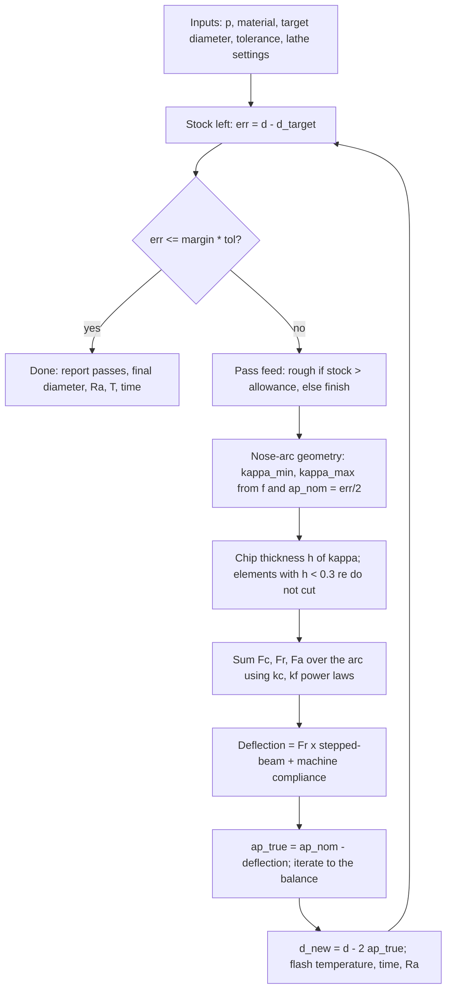

# Finish-turning model: how it works and why

Model for ME599/699 Final Exam Part 3 (AA7075 bar, 3/8 in -> 5/16 in, +/-0.0005 in, Ra 0.1-0.4 um).
Code: `turning_model.py` (`python turning_model.py --part3`). Demo: `deflection_model.ipynb`.

## Inputs and outputs

| Inputs | Outputs |
|---|---|
| Tool: nose radius `rc`, edge radius `re`, feed `f`, spindle speed | Forces Fc (tangential), Fr (radial), Fa (axial) |
| Workpiece: start diameter, overhang `L`, turned length `Ls`, target diameter, tolerance | Deflection (workpiece beam + machine), true vs nominal depth of cut |
| Material: E, kc1, mc, kf1, mf (power-law specific forces), thermal properties | Final diameter and error, pass-by-pass table |
| Thermal: heat partition `beta`, contact width `w_contact` | Kinematic Ra, torque and power, flash temperature, Peclet number |
| Lathe settings (rpm, feed lists) | Cycle time, MRR, fastest feasible setting, sensitivity table |

## UI

`python turning_ui.py` opens a window with the same inputs and outputs as the CLI. Both tabs share one editable
material table (pick a preset, then edit any value); press **Run** or Enter.

- **Single cut**: process inputs plus an optional target diameter. Shows the report and six figures: chip thickness
  vs kappa, element forces (dFc, dFf) and cumulative sums of Fc / Fradial / Faxial (the columns of the workbook's
  100-row table), deflection convergence, true vs nominal depth of cut, and the final forces.
- **Part 3 plan**: the exam bar, tolerance, Ra band, thermal inputs and the lathe lists. Mode *search* finds the
  fastest feasible setting (about 6 s), *fixed* runs the given feeds and rpm. Shows the pass table, the sensitivity
  table and six figures: convergence to the target, commanded vs true depth, forces, deflection, temperature and
  chip thickness per pass.
- Bad input (a non-number, an out-of-range depth) is reported in the text box instead of crashing.
- Tcl/Tk: run `.\setup_venv.ps1` once, then `.\.venv\Scripts\python turning_ui.py`. The venv holds its own copy of
  Tcl/Tk and a `sitecustomize.py` that points every interpreter in it at that copy, so a machine-wide
  `TCL_LIBRARY` / `TK_LIBRARY` from another Python install (which breaks `tk.Tk()`) is ignored. Outside the venv,
  `use_own_tcl` applies the same override to the UI process. Your environment variables are not changed.

## The deflection paradox and its solution

Cutting force depends on the depth of cut actually engaged, but that depth is reduced by the deflection the force
itself causes. A one-step calculation (force at the *nominal* depth, then deflection) over-predicts deflection
because it uses a force that is too large (here 301 um vs 270 um at the converged balance), while ignoring
deflection under-predicts it (zero). The true answer is the steady-state balance

    ap_true = ap_nom - C * Fr(ap_true)          C = beam compliance + machine compliance (mm/N)

solved by fixed-point iteration (0.5 under-relaxation; plain substitution oscillates 301, 262, 272, 269, 270 um
before settling, like the course workbook's rev2..rev10 sheets). If the edge-radius cutoff makes F(ap) slightly
jumpy, a bisection on `ap + deflection(ap) = ap_nom` takes over.

**Why passes, not one cut.** Beam compliance is about 12 um/N (101.6 mm cantilever, 9.5 mm bar), so the +/-12.7 um
tolerance corresponds to roughly 1 N of radial force. One 794 um cut leaves about 270 um of stock. The model
therefore turns with a sequence of passes, each commanded to the **target** diameter:

Because the set point never goes below the target, deflection can only leave stock, never remove too much, so a
wrong force or stiffness estimate costs extra passes rather than an undersize part. Each pass removes a fraction
of the remaining stock, so it shrinks geometrically (radial stock before each pass in the result below:
794, 270, 118, 57, 29, 16, 9, 5 um). The loop stops at `margin` (0.5) times the tolerance, leaving room for
model error.

## Result (Part 3, placeholder lathe settings)

Fastest setting meeting tolerance, Ra band and temperature: f = 0.05 mm/rev, 3000 rpm, all passes.

| Quantity | Value |
|---|---|
| Passes / cycle time | 8 passes, 20.3 s |
| Final diameter | 7.9437 mm (+6.2 um, tolerance +/-12.7 um) |
| First pass | commanded 794 um, true 524 um, Fc 41 N, Fr 22 N, deflection 270 um |
| Last pass | commanded 5 um, true 2 um, Fc 0.3 N, Fr 0.25 N |
| Kinematic Ra | 0.13 um (workbook 4/3 factor; band 0.1-0.4) |
| Peak workpiece surface temperature | 66 C (first pass), below the 150 C aging placeholder |

Sensitivity (nominal 8-pass plan replayed on a perturbed model; "re-plan" = passes needed if the plan is redone):

| Change | Final error | In tol | Re-plan |
|---|---|---|---|
| nominal | +6.2 um | yes | 8 |
| force +20% | +11.3 um | yes | 10 |
| force -20% | +2.7 um | yes | 7 |
| E +20% | +3.1 um | yes | 7 |
| E -20% | +13.0 um | **no** | 10 |
| machine stiffness +/-20% | +6.2 um | yes | 8 |

Force and workpiece stiffness set the pass count; machine stiffness (50 kN/mm) is negligible next to the
~83 N/mm workpiece. A 20% error in force or stiffness costs about two extra passes, not a failed part, which is
why the margin and the extra pass are part of the plan.

## Assumptions and limitations

- **Placeholders, not course data.** The lathe rpm/feed lists, `beta` = 0.2, `w_contact` = 0.1 mm, 7075 thermal
  properties and the 150 C critical temperature are literature-style placeholders; swap them for the course values
  (`LATHE`, `PART3`, `MATERIALS`, `T_CRIT_ALUMINIUM`). No reliable critical temperature exists for AA7075, so
  150 C (start of over-aging) is shown as an indicative band, with the 477 C solidus as the upper bound.
- kc/kf come from the course 7075 force fit (3 mm width data), assumed valid for rc = 0.8 mm. Rake and lead angle are
  taken as 0 (workbook geometry); flank angle is not modelled.
- Overhang is the full 101.6 mm (worst case) with the load at the free end; the beam is a stepped cantilever
  (un-turned bar behind a 6.35 mm turned section). Uniform pass; no axial variation, no chatter, no tool wear.
- Edge radius: elements thinner than 0.3 re form no chip. Ploughing force is **off** (`pl` = 0) until calibrated to
  measured forces (`calibrate_forces`); with it off the model ignores the thrust a 10 um edge adds on very thin
  final passes, so the last passes are optimistic. Ra is purely kinematic and may read low under ploughing.
- Flash temperature: Jaeger moving band source with Q = beta * Fc * vc over a band w x (engaged edge length).
- Validation against the supplied experimental data is not done yet: `compare()` and `calibrate_forces()` are ready.
